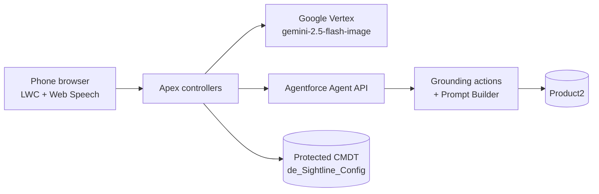

# Sightline

Point your phone camera at a product. An Agentforce agent identifies it and voice-guides setup with spoken step-cards.

## What it does

- Opens the phone camera and microphone in a public Salesforce Experience site (LWR, Guest User).
- Samples camera frames and sends them through Apex to Google Vertex (`gemini-2.5-flash-image`) for visual reasoning.
- Relays what you say (Web Speech STT) and what the camera sees to an Agentforce agent over the Agent API; the agent grounds answers with Prompt Builder templates over Product2 data.
- Speaks the answer (Web Speech TTS) and shows it as step-cards over the live feed.
- Two flows, two agents: **Video Troubleshooting** (fictional Velo Home appliances, such as the Velo FrostPro Slushie Maker) and **Auto Feature tour** (fictional Velo Motors vehicles).
- Escalation: logs a Case (appliances) or a Lead (vehicles), and can hand off to a live agent via Embedded Messaging.

See [docs/ARCHITECTURE.md](docs/ARCHITECTURE.md) for design decisions and flow detail.

## Architecture



## Components

| Component | Purpose |
|---|---|
| `lwc/de_videoReasoning` | Standalone camera + voice component: samples a frame every few seconds, gets spoken guidance from Vertex |
| `lwc/de_videoTroubleshoot` | Full troubleshooting flow: product picker, agent session, step-cards, Embedded Messaging handoff (`miaw.js`) |
| `lwc/de_autoFeatures` | Vehicle feature-tour flow (`miaw.js`) |
| `de_VideoReasoningController` | Sends a frame to Vertex, returns guidance text |
| `de_GoogleAuthService` | Service-account JWT bearer flow for Vertex |
| `de_AgentforceService` / `de_AutoAgentforceService` | Agent API sessions for each agent |
| `de_TroubleshootingGrounding` / `de_AutoFeatureGrounding` | Agent actions that call Prompt Builder templates |
| `de_ProductService` / `de_AutoProductService` | Guest-safe product lists |
| `de_CaseService` / `de_AutoLeadService` | Case / Lead logging (invocable + AuraEnabled) |
| `de_VideoCaptureService` | Saves a captured frame as a File with a public link |
| `de_Sightline_Config__mdt` | Protected CMDT holding all configuration and secrets |
| `aiAuthoringBundles/`, `bots/`, `genAiPlannerBundles/` | The two agents (`de_Video_Troubleshooting_Agent`, `de_Auto_Feature_Agent`) |
| `genAiPromptTemplates/` | `Product_Troubleshooting_Video`, `Car_Feature_Video` |
| `sites/`, `networks/`, `digitalExperiences/` | Guest Experience site shell |

## Prerequisites

- Salesforce CLI (`sf`), a Dev Hub or sandbox/developer org with Agentforce, Prompt Builder and Experience Cloud enabled.
- A Google Cloud project with Vertex AI enabled and a service account allowed to call `gemini-2.5-flash-image` (`us-central1`).
- Two External Client Apps / Connected Apps for the Agent API (client credentials flow), one per agent.

## Setup and deploy

```bash
sf project deploy start --source-dir force-app --target-org <alias>
sf apex run --file scripts/seed_appliances.apex --target-org <alias>   # fictional Velo Home products
sf apex run --file scripts/seed_vehicles.apex   --target-org <alias>   # fictional Velo Motors vehicles
```

Then publish and activate the two agents from the authoring bundles, create the Experience site pages, and grant the Guest profile and permission sets access to the Apex classes.

## Configuration

Everything secret or org-specific is a `REPLACE_ME` placeholder in the repo. Fill these in the target org only; never commit real values.

| Where | What |
|---|---|
| Custom Metadata `de_Sightline_Config.Troubleshooting_Agent` | `Consumer_Key__c`, `Consumer_Secret__c`, `Agent_Id__c`, `My_Domain_Url__c`, `API_Base_Url__c` |
| Custom Metadata `de_Sightline_Config.Auto_Agent` | Same fields for the vehicle agent |
| Custom Metadata `de_Sightline_Config.Google_Vertex` | `Client_Email__c`, `Private_Key__c`, `Project_Id__c` of the service account |
| `lwc/de_videoTroubleshoot/miaw.js`, `lwc/de_autoFeatures/miaw.js` | `MIAW_SCRT2_URL`, `MIAW_ORG_ID` (and deployment names) for Embedded Messaging |
| Remote Site `de_Salesforce_MyDomain` | Your My Domain URL |
| `sites/Video_Reasoning`, `networks/*`, `bots/*`, `aiAuthoringBundles/*.agent` | Replace `REPLACE_ME_*@example.com` admin and agent-user usernames |
| Messaging channel | Create the Omni flow `Sightline_Messaging_Omni_Flow` and queue `Sightline_Messaging_Queue`, or point the channel at your own |

Smoke tests: `scripts/test_grounding.apex` and `scripts/test_agent_session.apex`.

## Screenshots

Add screenshots to `docs/screenshots/`.

## License

MIT, see [LICENSE](LICENSE).
