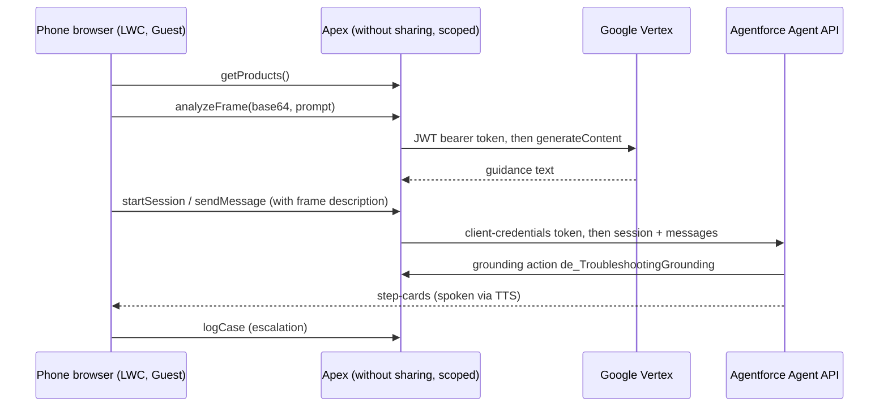

# Sightline: Architecture and Design Notes

Sightline lets someone point a phone camera at a physical product. An Agentforce agent identifies it and voice-guides setup or troubleshooting with spoken step-cards over the live camera feed. The demo product is a fictional Velo FrostPro Slushie Maker; a second flow does the same for fictional Velo Motors vehicles.

## Decisions

| Topic | Decision |
|---|---|
| Hosting | Salesforce-hosted LWR Experience site (`*.my.site.com`) running as the Guest User. Public, no extra hosting, native Salesforce auth. |
| Why not an external host | An external front end would need a Connected App, OAuth and CORS for every Agentforce call, and adds a second place to secure. |
| Vision and voice | Pattern: the vision model sees, Agentforce grounds. Voice uses the browser Web Speech API (`SpeechRecognition` for STT, `SpeechSynthesis` for TTS), not Agentforce Voice (which is telephony). |
| Vision model | Google Vertex `gemini-2.5-flash-image` (`:generateContent`), multimodal in, text out. Called server-side from Apex. |
| Agent | Agentforce Agent API (client-credentials OAuth), one agent per flow, authored as Agent Script bundles. |
| Secrets | Protected Custom Metadata (`de_Sightline_Config__mdt`). Committed values are `REPLACE_ME`. Guest users cannot read protected CMDT; only Apex can. |

## Flow 1: Video Troubleshooting (appliances)

1. The user picks a product (Product2 rows with `Family = 'Troubleshooting'`).
2. The camera feed is sampled; frames go through `de_VideoReasoningController.analyzeFrame` to Vertex for visual reasoning.
3. `de_AgentforceService` opens an Agent API session and relays the user's speech plus a description of what the camera sees.
4. The agent calls `de_TroubleshootingGrounding`, which invokes the Prompt Builder template `Product_Troubleshooting_Video` and grounds the rest of the conversation on the returned guide.
5. Replies are rendered as step-cards and read aloud. On "talk to an expert", `de_CaseService` logs a Case and the LWC can hand off to a live agent over Embedded Messaging (MIAW), with `de_VideoCaptureService` saving a captured frame as a public File link to share.

## Flow 2: Auto Feature tour (vehicles)

Same shape, with a separate agent (`de_Auto_Feature_Agent`) and config record (`Auto_Agent`). Vehicles come from Product2 with `Family = 'Auto POC'` via `de_AutoProductService`; `de_AutoFeatureGrounding` + the `Car_Feature_Video` prompt template ground answers strictly on the seeded spec; `de_AutoLeadService` captures a Lead for "book a test drive".

## Security model

- Guest-facing Apex classes are `without sharing` but each query is scoped (Family filter, `IsActive`) and returns only display fields.
- No credential reaches the browser. Agent API keys and the Google service-account key live only in protected CMDT read inside Apex.
- Browser-side Embedded Messaging config (`miaw.js`) holds only non-secret identifiers (SCRT2 host, org ID, deployment name), shipped as `REPLACE_ME`.
- Guest profile access is limited to the Apex classes it needs.

## Known limits

- Turn-based, not streaming: frame analysis uses `gemini-2.5-flash-image` (the troubleshooting LWC also references `gemini-2.5-flash` for object location, which needs to be enabled in your project), so there is no continuous Gemini Live session or native barge-in. The vision and voice layer is modular and could be swapped for a streaming model.
- Web Speech support varies by browser; Chrome and Safari on phones work best.
- The authoring bundles are Agent Script sources; publish and activate them yourself in your org.

## Conventions

`de_` prefix on all Apex/LWC/metadata; agents stay in draft until you publish them; clone rather than modify shared components.
